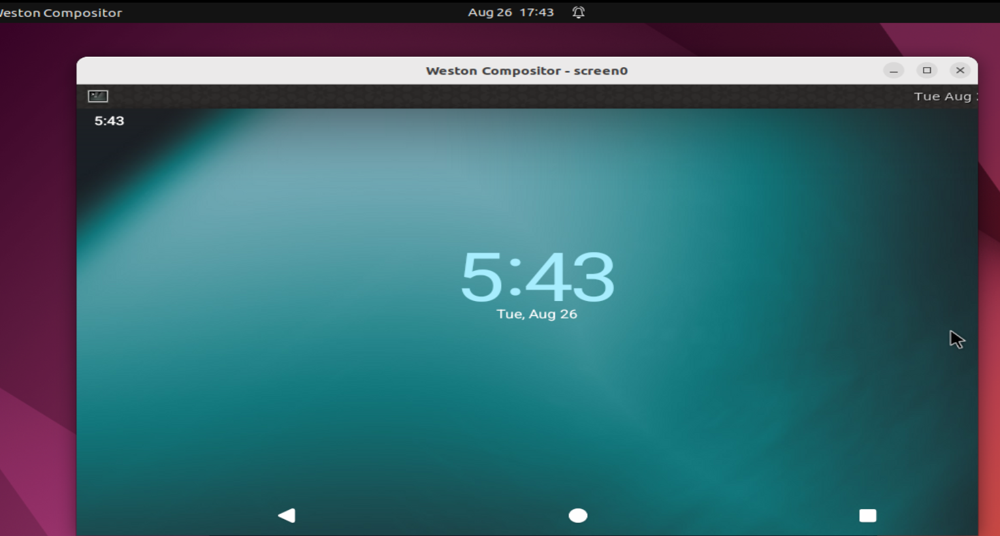

# waydroid

作用： 

> Andriod container  on  **any**  GNU/Linux system like Ubuntu
>
> 容器方案

docs：

> https://waydro.id/     总网站
>
> https://docs.waydro.id/


一些点：

> 1、The used image is currently based on Android 11    ----->  结论： 安卓部分是不动的，可能很难改动？
>
> ​                                                                                          <font color='red'>  疑问：</font> Hos 是否是同样的方式？ 即 Hos的安卓部分是否跟随Google大版本演进？ （有必要的：因为应用会演进）
>
> 2、ARM转译层： 
>
> 
>
> 如果宿主机是X86_64，自然**需要ARM转译层**(libhoudini或libndk)的支持才能运行绝大多数手机app  ----> 手机不存在这个问题
>
> 

-<font color='red'>疑问：</font>

> 1、<font color='red'>一个屏幕</font>，必然存在的问题：**buffer的走向问题**------------窗口的渲染数据，底层是给到安卓侧还是linux侧？
>
> 

教程：

> https://zhuanlan.zhihu.com/p/631327119       在Archlinux上使用waydroid运行安卓app 。 注意： 宿主机器 pc  linux（x86）
>
> https://docs.waydro.id/usage/install-on-desktops    安装教程
>
> https://zhuanlan.zhihu.com/p/603603346  linux上运行android：waydroid终于安装成功并可上网、安装程序 --------> **验证OK的教程**
>
> 涉及<font color='red'>两个镜像替换</font>：**image使用的是 LineageOS编译出来的** -----> 这
>
> TODO 图


安装结果：

>   点击
>
>   
>
>   

源码：

> https://github.com/waydroid/waydroid


注意点：

> TODO 图


## TODO

TODO：可以自己编译 waydroid适配层吗？hwc

TODO：自然img可以自己编译


## 安装遇到的问题：

### Waydroid session fails to start

https://github.com/waydroid/waydroid/issues/294


解决办法----------**取消waydroid的硬件加速：**

```java
Disabling hardware acceleration in /var/lib/waydroid/waydroid_base.prop by setting

ro.hardware.gralloc=default
ro.hardware.egl=swiftshader
```


# LineageOS

官网：https://lineageos.org/

源码：

```java
cd ~/android/lineage
repo init -u https://github.com/LineageOS/android.git -b lineage-16.0
repo sync
注：这里的lineage-16.0是分支名,对应Android 9.0。更多分支请浏览：https://github.com/LineageOS/android


cd device/xiaomi
git clone https://github.com/LineageOS/android_device_xiaomi_chiron -b lineage-16.0 chiron
```

参考：https://www.cnblogs.com/luoyesiqiu/p/10701419.html        [自己动手编译Android(LineageOS)源码](https://www.cnblogs.com/luoyesiqiu/p/10701419.html)


