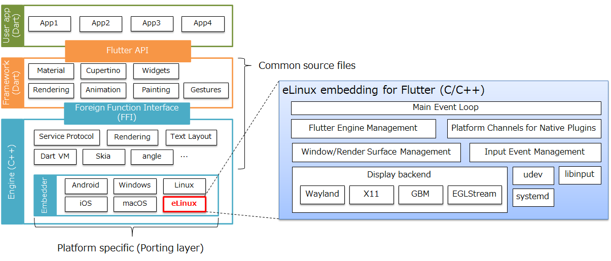
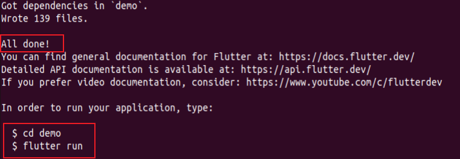
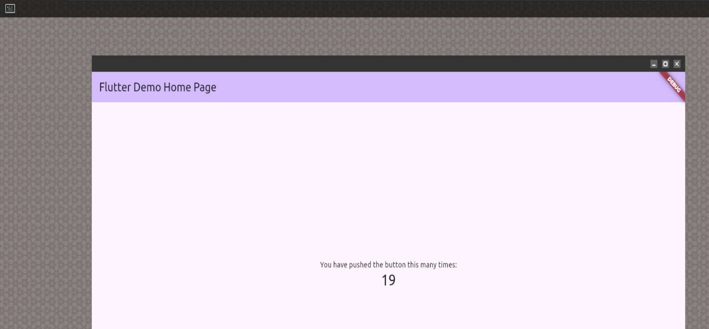
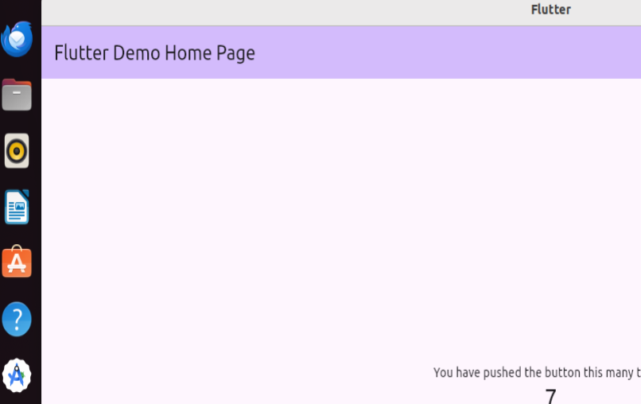
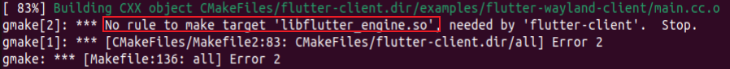
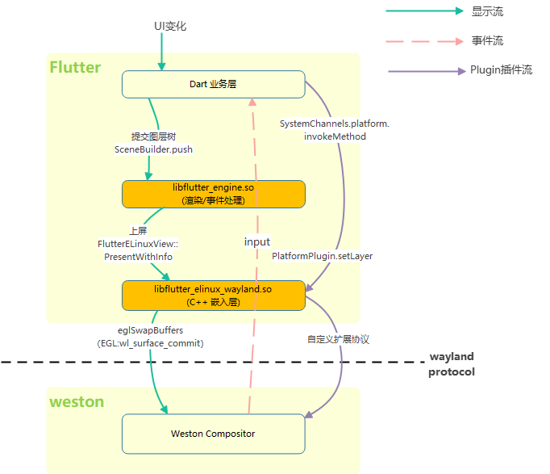
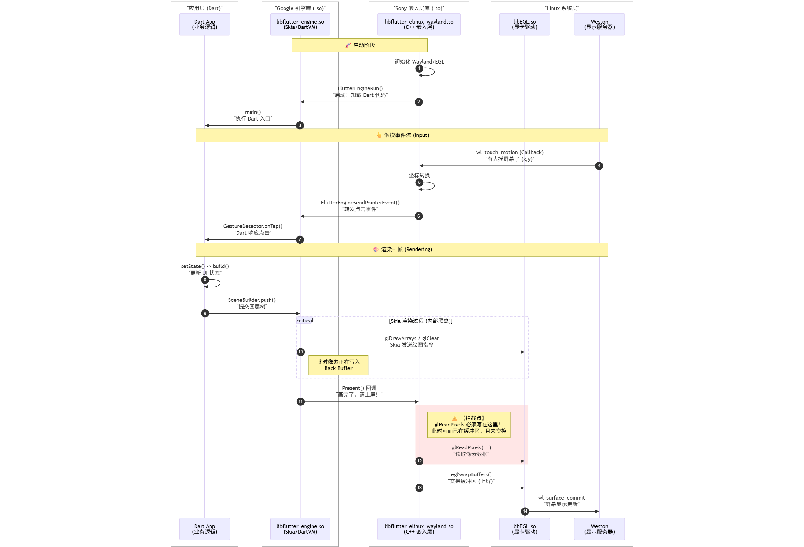

# X86下运行flutter

## 参考文章：

https://blog.csdn.net/gitblog_01030/article/details/141247141    Flutter eLinux 项目教程

https://github.com/sony/flutter-elinux  官网

https://github.com/HidenoriMatsubayashi/HidenoriMatsubayashi?tab=readme-ov-file  

https://elinux.org/images/f/f1/Jamboree77-Flutter-for-embedded-systems.pdf  ----------> 好文，架构图！！！！！

>   local：https://kenttj.github.io/markdownbook/book2/编译flutter.assets/Jamboree77-Flutter-for-embedded-systems.pdf  

 [Graphical User Interface Using  Flutter in Embedded Systems](https://static.sched.com/hosted_files/osseu2020/e0/Oct%2027_Graphical%20User%20Interface%20Using%20Flutter%20in%20Embedded%20Systems_Hidenori%20Matsubayashi.pdf?_gl=1*163gmpb*_gcl_au*MTQ3MzQ0Njc0Mi4xNzY1MTE3Mzk2)

## 总览结构

注：索尼的的、非官方项目



1、~~Flutter eLinux（app开发工具）~~

>   （1）提供了 **开发工具**： 提供了在嵌入式 Linux 设备上构建和调试 Flutter 应用程序所需的工具
>
>   （2）提供了 flutter-embedded-linux<font color='red'>已经预编译的so</font>（保证不编译flutter-embedded-linux，app可以运行）：
>
>   ```java
>   $ ls -la ./flutter-elinux/flutter/bin/cache/artifacts/engine/elinux-x64-debug/
>   libflutter_elinux_eglstream.so
>   libflutter_elinux_gbm.so
>   libflutter_elinux_wayland.so  // 【】系统事件、显示相关
>   libflutter_elinux_x11.so
>   ```
>   <------------  <font color='red'>flutter-embedded-linux仓（**核心，但非必要**）编译而来:</font>
> [!NOTE]
> >   
> >   提供了 Flutter 引擎在 eLinux 上运行的<font color='red'>系统基础</font>:  如输入处理（键盘、鼠标、触摸）、渲染到显示后端（如 
> >
> >   Wayland、DRM/GBM）、事件循环以及平台特定代码和 Flutter 框架之间的通信。
> >
> >   编译产物：
> >
> >   ```java
> >   libflutter_elinux_eglstream.so
> >   libflutter_elinux_gbm.so
> >   libflutter_elinux_wayland.so
> >   libflutter_elinux_x11.so
> >   libflutter_engine.so
> >   ```
>
>   
>   （3）函预编译so：
>
>   ```java
>   $ ls -la ./flutter-elinux/flutter/bin/cache/artifacts/engine/elinux-x64-debug/
>   libflutter_engine.so   // 【】flutter引擎？？？？source code：
>   ```
>
>   

2、~~flutter-elinux-plugins（非必要）~~:

>   扩展功能, & Flutter 插件：允许 Dart 代码与平台特定的功能进行交互（例如访问摄像头、播放视频、读写文件等）


3、~~meta-flutter（非必要）~~: 

>    Yocto  构建系统集成


##  Flutter eLinux工具 （运行app必要）

1、 Flutter eLinux工具安装：

```java
git clone https://github.com/sony/flutter-elinux.git
cd flutter-elinux
```

------->  注意：**不会编译**（已经是预编译好的工具 & so）

2、环境加入flutter-elinux环境变量：

目的：能使用环境变量flutter-elinux

```java
vim ~/.bashrc

#kent add
export PATH=$PATH:/home/kent/workingspace_disk2/flutter/flutter-elinux/bin
```

3、创建app应用工程

```java
flutter-elinux create my_app
```

成功标志：




**在wayland环境下（比如weston）**：

```java
cd my_app
flutter-elinux run -d elinux-wayland   // 【】 这一步 build & 运行
```




也可以在x11环境上跑：

>   
>
>   ```java
>   flutter-elinux run -d elinux-x11
>   ```
>
>   


**只运行 不编译：**

>   ```java
>   ./build/elinux/x64/debug/bundle/my_app --bundle=/home/chengang/workingspace_disk2/flutter/flutter-demo/my_app/build/elinux/x64/debug/bundle 
>   ```
>
>   -------------------> **优点：可以看到控制台的日志**


## 插件（扩展能力）flutter-elinux-plugins（app编译非必要）

Flutter eLinux 提供的插件，如 `video_player_elinux` 和 `camera_elinux`，来扩展应用的功能

项目：https://github.com/sony/flutter-elinux-plugins


## 编译 flutter-embedded-linux（app编译非必要）

**编译目标产物：libflutter_elinux_wayland.so**

编译目的：**如果扩展了wayland协议，**必须编译自己的 libflutter_elinux_wayland.so

### 编译教程

官方wiki：https://github.com/sony/flutter-embedded-linux/wiki

编译教程：https://github.com/sony/flutter-embedded-linux/wiki/Building-Embedded-Linux-embedding-for-Flutter

```java
~/workingspace_disk2/flutter$
git clone  https://github.com/sony/flutter-embedded-linux.git
```

编译：

```java
$ cd flutter-embedded-linux/
$ rm -rf build/ && mkdir build  
 $ cp ../flutter-elinux/flutter/bin/cache/artifacts/engine/elinux-x64-release/libflutter_engine.so ./build/
 $  cd build 
$ cmake -DUSER_PROJECT_PATH=examples/flutter-wayland-client  -DBUILD_ELINUX_SO=ON -DBACKEND_TYPE=WAYLAND -DCMAKE_BUILD_TYPE=Release  -DENABLE_ELINUX_EMBEDDER_LOG=ON -DFLUTTER_RELEASE=OFF ..
$ cmake --build .
```

~~报错：~~

>   
>
>   编译前：需要添加 编译依赖libflutter_engine.so ：
>
>   ```java
>   // 从 编译工具flutter-elinux copy到 flutter-embedded-linux目录下
>   $ cp ./flutter-elinux/flutter/bin/cache/artifacts/engine/elinux-x64-release/libflutter_engine.so ./flutter-embedded-linux/build/
>   ```


产物：

```java
[ 83%] Linking CXX shared library libflutter_elinux_wayland.so // 【】
[100%] Built target flutter_elinux_wayland
```


替换产物到  flutter-elinux下：

```java
 cp ./flutter-embedded-linux/build/libflutter_elinux_wayland.so ./flutter-elinux/flutter/bin/cache/artifacts/engine/elinux-x64-release/libflutter_elinux_wayland.so
 
 cp ./flutter-elinux/flutter/bin/cache/artifacts/engine/elinux-x64-debug/libflutter_elinux_wayland.so ./flutter-elinux/flutter/bin/cache/artifacts/engine/elinux-x64-debug/libflutter_elinux_wayland.so_backup
```

---------------> app编译时，会自动利用  flutter-elinux

## 编译自己的 libflutter_engine.so （非必要）

**libflutter_engine.so 是引擎代码的产物**

教程：https://github.com/sony/flutter-embedded-linux/wiki/Building-Flutter-Engine-from-source


# flutter

## 参考：

https://www.alibabacloud.com/blog/exploration-of-the-flutter-rendering-mechanism-from-architecture-to-source-code_597285  

http://guoshuyu.cn:9528/home/wx/Flutter-0.html  **GSY** 系列文章


## 架构图


]]


见《flutter.eddx》

### 关于插件

```java
========================================================================================
                          【 第 1 层：前端应用层 (运行在 Dart VM 中) 】
                          
[ Dart UI 业务代码 ]  --->  请求: MethodChannel("com.sony/video").invokeMethod("play")
========================================================================================
                                     |
                                     | (跨越语言边界：Dart 对象被序列化为 二进制数据流)
                                     v
========================================================================================
                          【 第 2 层：核心引擎层 (libflutter_engine.so) 】
                          
[ Flutter Engine ]    --->  职责：光栅化渲染、管理 Dart Isolate。
                            对插件逻辑【完全无知】。只负责把二进制数据跨线程搬运。
========================================================================================
                                     |
                                     | (引擎通过 C API: FlutterPlatformMessageCallback 抛出数据)
                                     v
========================================================================================
                          【 第 3 层：系统嵌入层 (libflutter_elinux_wayland.so) 】

[ Embedder 宿主环境 ] ---> 包含 EGL Context、Wayland Surface 生命周期管理。
      │
      └─> [ Plugin Registrar (消息分发路由器) ]
                职责：维护一张 Map <Channel Name, Plugin Callback>
                匹配：检测到通道名为 "com.sony/video"
                分发：将数据路由给下方对应的具体插件。
========================================================================================
             | (内部 C++ 函数指针调用)           |                           |
             v                                v                           v
========================================================================================
                          【 第 4 层：独立插件层 (按需编译的外部 .so) 】
                          
[libvideo_elinux_plugin.so]   [libnetwork_elinux_plugin.so]   [libcustom_wayland_ext.so]
  (处理视频解码/渲染逻辑)         (调用 Linux 网络状态 API)        (通过共享的 wl_display)
                                                                (向 Weston 发送自定义指令)
========================================================================================
             |                                 |                           |
             v                                 v                           v
========================================================================================
                          【 第 5 层：宿主操作系统层 (Linux OS / Weston) 】

[ GStreamer 硬件解码 ]            [ NetworkManager D-Bus ]      [ Weston Compositor ]
========================================================================================
```


## 纵向流程





[^1]


[^1]: sequenceDiagram

	    autonumber
	
	    %% 定义参与者分组 (Box)
	
	    box "应用层 (Dart)" #e1f5fe
	
	        participant App as Dart App<br/>(业务逻辑)
	
	    end


​	  
​	
​	    box "Google 引擎库 (.so)" #e3f2fd
​	
	        participant Engine as libflutter_engine.so<br/>(Skia/DartVM)
	
	    end


​	  
​	
​	    box "Sony 嵌入层库 (.so)" #ffccbc
​	
	        participant Embedder as libflutter_elinux_wayland.so<br/>(C++ 嵌入层)
	
	    end


​	  
​	
​	    box "Linux 系统层" #f5f5f5
​	
	        participant EGL as libEGL.so<br/>(显卡驱动)
	
	        participant Weston as Weston<br/>(显示服务器)
	
	    end


​	  
​	
​	    %% ==========================
​	
	    %% 阶段 1: 启动 (Startup)
	
	    %% ==========================
	
	    Note over Embedder, Engine: 🚀 启动阶段
	
	    Embedder->>Embedder: 初始化 Wayland/EGL
	
	    Embedder->>Engine: FlutterEngineRun()<br/>"启动！加载 Dart 代码"
	
	    Engine->>App: main()<br/>"执行 Dart 入口"


​	  
​	
​	    %% ==========================
​	
	    %% 阶段 2: 交互 (Input Flow)
	
	    %% ==========================
	
	    Note over Weston, App: 👆 触摸事件流 (Input)
	
	    Weston->>Embedder: wl_touch_motion (Callback)<br/>"有人摸屏幕了 (x,y)"
	
	    Embedder->>Embedder: 坐标转换
	
	    Embedder->>Engine: FlutterEngineSendPointerEvent()<br/>"转发点击事件"
	
	    Engine->>App: GestureDetector.onTap()<br/>"Dart 响应点击"
	
	    %% ==========================
	
	    %% 阶段 3: 渲染 (Render Flow)
	
	    %% ==========================
	
	    Note over App, Weston: 🎨 渲染一帧 (Rendering)
	
	    App->>App: setState() -> build()<br/>"更新 UI 状态"
	
	    App->>Engine: SceneBuilder.push()<br/>"提交图层树"
	
	    critical Skia 渲染过程 (内部黑盒)
	
	        Engine->>EGL: glDrawArrays / glClear<br/>"Skia 发送绘图指令"
	
	        Note right of Engine: 此时像素正在写入<br/>Back Buffer
	
	    end


​	  
​	
​	    Engine->>Embedder: Present() 回调<br/>"画完了，请上屏！"
​	
	    %% ==========================
	
	    %% 核心修改点 (Hook Point)
	
	    %% ==========================
	
	    rect rgb(255, 230, 230)
	
	        Note right of Embedder: ⚠️ 【拦截点】<br/>glReadPixels 必须写在这里！<br/>此时画面已在缓冲区，且未交换
	
	        Embedder->>EGL: glReadPixels(...)<br/>"读取像素数据"
	
	    end
	
	    Embedder->>EGL: eglSwapBuffers()<br/>"交换缓冲区 (上屏)"
	
	    EGL->>Weston: wl_surface_commit<br/>"屏幕显示更新"
